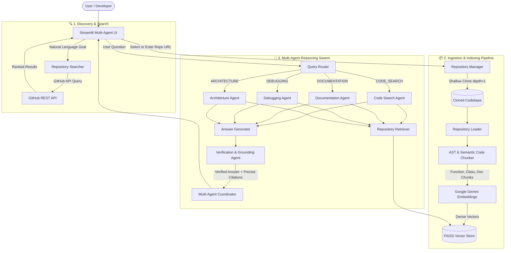

# 🤖 TalkToGitHub — Autonomous Multi-Agent Code Intelligence

> **Discover, Ingest, AST-Chunk, and Converse with Any GitHub Codebase with Grounded Multi-Agent Intelligence.**

TalkToGitHub is a complete end-to-end AI system that turns any GitHub repository into an interactive, grounded knowledge base. Powered by **AST (Abstract Syntax Tree) code chunking**, **semantic vector search (FAISS)**, an **intelligent Query Router**, and a **swarm of specialized AI Agents** backed by a **Verification & Hallucination-Checking Agent**.

---

## 🏛️ System Architecture



---

## 🚀 Key Features

### 1. 🔍 Task-Driven Repository Discovery
- Search GitHub repositories using plain natural language goals (e.g., *"I want to build a RAG chatbot using LangChain"*).
- Intelligent stop-word filtering, technical keyword extraction, and multi-factor ranking based on stars, forks, and topic relevance.

### 2. ⚡ Fast Shallow Cloning & Language-Aware File Filtering
- Uses Git shallow cloning (`depth=1`) for speed and minimal disk space.
- Smart filters that ignore binaries, build artifacts (`node_modules`, `__pycache__`, `.venv`, `dist`, `.git`), and lockfiles while indexing all major programming and configuration languages.

### 3. 🧩 Python AST & Markdown Semantic Chunking
- Parses Python source files into **Abstract Syntax Trees (AST)** to extract discrete functions, async routines, classes, methods, docstrings, and imports with exact start and end line ranges.
- Chunks Markdown files hierarchically along heading boundaries (`#`, `##`, `###`).
- Preserves full symbol metadata (`symbol`, `symbol_type`, `file_path`, `start_line`, `end_line`).

### 4. 🤖 Multi-Agent Reasoning Swarm
- **`QueryRouter`**: Classifies questions into specialized routes (`CODE_SEARCH`, `DOCUMENTATION`, `DEBUGGING`, `ARCHITECTURE`, `GENERAL`).
- **`CodeSearchAgent`**: Pinpoints exact function definitions, class structures, imports, and variables with line numbers and preview snippets.
- **`DocumentationAgent`**: Analyzes setup instructions, prerequisites, configuration options, and dependencies.
- **`DebuggingAgent`**: Conducts Root Cause Analysis on errors, stack traces, and unhandled exceptions, providing step-by-step verified fixes.
- **`AnalysisAgent`**: Delivers high-level architectural breakdowns, component interactions, and data flow pipelines.
- **`VerificationAgent`**: Validates generated claims, backtick code snippets, and file paths against retrieved context to prevent hallucinations and calculate a grounding confidence score.

### 5. 💻 Modern Streamlit Web Application
- Sleek dark UI with custom typography, glassmorphism cards, and glowing metric badges.
- **Tab 1: Discover Repositories**: Search, filter by language/stars, and 1-click ingest.
- **Tab 2: Ingest Codebase**: Direct URL ingestion with real-time pipeline status and analytics.
- **Tab 3: Multi-Agent Chat Studio**: Conversational history, agent routing badges, verified citations accordion, and raw chunk inspector.
- **Tab 4: Code Explorer & AST**: Interactive file picker with syntax highlighting and AST symbol table.
- **Tab 5: Diagnostics & Cache**: Manage local clones and FAISS vector indices.

---

## 🛠️ Tech Stack & Dependencies

- **Language**: Python >= 3.12
- **Agentic / RAG Framework**: LangChain (`langchain-core`, `langchain-community`, `langchain-groq`, `langchain-google-genai`)
- **LLMs & Inference**: Groq (`openai/gpt-oss-20b`, `openai/gpt-oss-120b`, `qwen/qwen3.8-27b`) & Google Gemini (`gemini-3.8-flash`)
- **Embeddings**: Google Generative AI (`models/gemini-embedding-001`)
- **Vector Database**: FAISS (Facebook AI Similarity Search, `faiss-cpu`)
- **Version Control**: GitPython
- **Web UI**: Streamlit

---

## 📦 Installation & Setup

### 1. Clone or Open the Repository
```bash
git clone https://github.com/your-username/talk-to-github.git
cd talk-to-github
```

### 2. Set Up Virtual Environment & Dependencies
Using `uv`:
```bash
uv sync
```
Or using standard `pip`:
```bash
python -m venv .venv
# On Windows
.venv\Scripts\activate
# On Linux/macOS
source .venv/bin/activate

pip install -e .
```

### 3. Configure Environment Variables (`.env`)
Create a `.env` file in the root directory:
```env
# GitHub API Token (Optional, for higher search rate limits)
GITHUB_TOKEN=ghp_your_github_personal_access_token

# Google Gemini API Key (For Embeddings & Gemini LLM)
GEMINI_API_KEY=your_gemini_api_key

# Groq API Key (For High-Speed LLM Inference)
GROQ_API_KEY=your_groq_api_key
```

---

## 🚀 Running the Application

### Launch Streamlit Web UI
```bash
streamlit run app.py
```
Open [http://localhost:8501](http://localhost:8501) in your browser.

### Run Automated Integration Tests
```bash
# Test Query Router
python test_router.py

# Test Multi-Agent System end-to-end
python test_agent.py

# Test Source Locator
python test_locator.py
```

---

## 📂 Project Directory Structure

```
talk-to-github/
├── .env                       # API keys (Groq, Gemini, GitHub)
├── app.py                     # Streamlit Multi-Agent Web Application
├── pyproject.toml             # Project metadata & dependencies
├── README.md                  # System documentation
├── test.py                    # RAG pipeline test
├── test_agent.py              # Multi-Agent integration test
├── test_locator.py            # Source code line locator test
├── test_router.py             # Query classifier test
├── config/
│   ├── __init__.py
│   └── settings.py            # Central system & model configurations
├── github/
│   ├── __init__.py
│   ├── client.py              # GitHub REST API client
│   ├── repository.py          # Git shallow cloning & stats manager
│   └── search.py              # Natural language query search & ranker
├── rag/
│   ├── __init__.py
│   ├── chunker.py             # Python AST & Markdown chunking
│   ├── embeddings.py          # Gemini embedding manager
│   ├── generator.py           # Grounded response generator
│   ├── loader.py              # Codebase loader & file filtering
│   ├── retriever.py           # FAISS semantic retriever
│   └── vector_store.py        # Vector index creation & persistence
├── agents/
│   ├── __init__.py
│   ├── router.py              # Query classifier
│   ├── coordinator.py         # Multi-Agent orchestrator
│   ├── code_search_agent.py   # Exact symbol & line location agent
│   ├── documentation_agent.py # Setup & guide agent
│   ├── debugging_agent.py     # Root-cause triage & fix agent
│   ├── analysis_agent.py      # Architecture & system design agent
│   └── verification_agent.py  # Hallucination & grounding verifier
├── utils/
│   ├── __init__.py
│   ├── file_filter.py         # Extension whitelist & ignore rules
│   ├── helpers.py             # LLM factory, cleanup & formatting
│   └── source_locator.py      # Code line bound locator
└── data/
    ├── repositories/          # Cloned repository storage
    └── vector_store/          # Cached FAISS vector stores
```

---

## 🔒 Grounding & Anti-Hallucination Guarantee

Every answer generated by TalkToGitHub passes through the **`VerificationAgent`**, which verifies that:
1. All referenced code calls (`function()`, `variable = ...`, `import ...`) strictly exist in the retrieved codebase evidence.
2. All file names mentioned match actual source code files in the repository.
3. Every citation is grounded with line number ranges and code previews.
